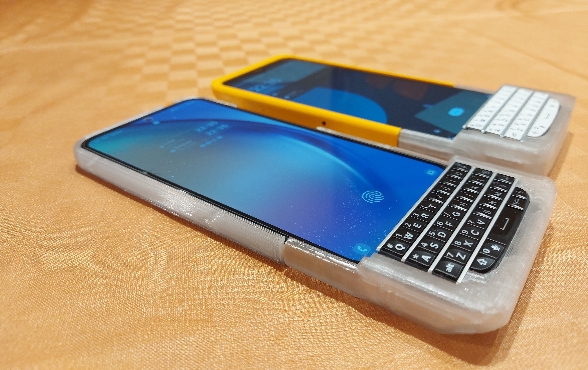

# Fairberry

The goal of this project is to add a BlackBerry Q10 keyboard to non-BlackBerry phones. While this can easily be adapted to suit any other phone with an USB port at the bottom, I will focus on releasing files for the Fairphone 4, since that is what I have. Feel free to adjust it to your phone and share your results in the discussion area.

The Fairberry keyboard is detachable and can be used without any modifications on the phone. Since it connects over USB, there is no need for separate batteries or glitchy Bluetooth connections.

## What can you expect?



### Demo video
[](https://www.youtube.com/watch?v=iDb8_ld9gOQ)

## How to build it?

Recommended: [Custom mainboard](https://github.com/Dakkaron/Fairberry/blob/main/Documentation/Hardware_Fairberry_Mainboard.md)

[Old Arduino-based hardware](https://github.com/Dakkaron/Fairberry/blob/main/Documentation/Hardware_Arduinobased.md)

## How to use it?

[Key combinations and apps](https://github.com/Dakkaron/Fairberry/blob/main/Documentation/UX_Shortcuts_and_Apps.md)

## Firmware and companion app

The keyboard firmware (`BBQ10/`) has a runtime-editable keymap: it can be
changed live over the keyboard's USB serial interface and is persisted to
EEPROM, so custom layouts survive reboot. Build it with:

```sh
arduino-cli compile --fqbn arduino:avr:leonardo \
  --libraries BBQ10/libraries --export-binaries BBQ10
```

which writes the image to `BBQ10/build/arduino.avr.leonardo/BBQ10.ino.hex`.

The Android companion app (`AndroidApp/`) lets you edit the keymap on your
phone and flash new firmware images through the keyboard's USB bootloader —
no computer required. See the [companion app documentation](Documentation/AndroidApp.md).
